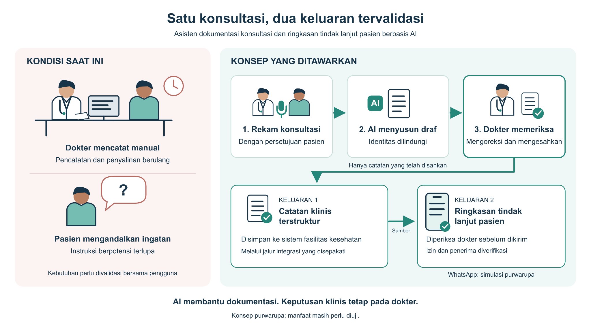

# VeriScribe (PlayItPlus)

**Asisten AI dokumentasi klinis berbasis verifikasi dokter, dengan ringkasan pasien yang konsisten.**

VeriScribe membantu dokter rawat jalan mengubah percakapan konsultasi menjadi dua keluaran yang tervalidasi dari satu proses:

1. **Draf catatan klinis terstruktur (SOAP)** untuk tenaga kesehatan, dan
2. **Ringkasan tindak lanjut berbahasa sehari-hari** untuk pasien.

Nama **VeriScribe** adalah judul proposal proyek ini; **PlayItPlus** adalah nama purwarupa yang berjalan (demo: https://playitplus.vercel.app/). Konsep lengkap ada di `docs/KONSEP_PROYEK.md`.

> **Singkatnya:** dokter cukup berbicara dengan pasien seperti biasa. VeriScribe yang mendengarkan percakapan itu, menuliskan draf catatannya, dan menyiapkan ringkasan untuk pasien. Dokter tinggal membaca, memperbaiki bila perlu, dan menyetujui.

> **Tentang proyek ini:** VeriScribe dibuat untuk **lomba PLAY IT Hackathon DeepTech 2026 (PlayItPlus)**, kategori Digitalisasi AI Bidang Kesehatan.
>
> **Status demo — mohon dibaca:** sistem ini **bekerja 100%** dari ujung ke ujung (rekam → transkrip → deidentifikasi → draf SOAP → ringkasan pasien) selama API key LLM/STT terpasang. Saat ini **API key LLM pada demo yang terpasang sudah dicabut karena alasan biaya**, jadi demo publik di https://playitplus.vercel.app/ tidak memanggil AI sungguhan sampai key dipasang lagi. Ini murni soal biaya pemakaian, bukan karena sistemnya belum jadi: untuk menjalankannya penuh, isi key Anda sendiri di `backend/.env` (lihat bagian Konfigurasi backend), atau jalankan mode `mock` untuk melihat alurnya tanpa key.

> Prinsip yang tidak berubah: **AI membantu dokumentasi. Keputusan klinis tetap pada dokter.** Sistem tidak menetapkan diagnosis, tidak meresepkan obat, dan tidak menggantikan keputusan dokter. Draf AI bersifat usulan — final hanya setelah dokter memeriksa, mengoreksi, dan mengesahkannya.



*Ilustrasi konsep: kondisi saat ini (kiri) dibanding alur yang ditawarkan VeriScribe (kanan).*

## Tujuan Kami

Bayangkan satu kali konsultasi di klinik atau puskesmas. Dalam waktu yang singkat itu, dokter harus melakukan dua pekerjaan sekaligus: mendengarkan dan memeriksa pasien, **dan** menulis catatan hasil pemeriksaan. Akibatnya waktu dokter banyak habis untuk menulis, bukan untuk pasien. Sebaliknya, pasien pulang hanya bermodal ingatan: obat apa yang harus diminum, bagaimana aturannya, dan kapan harus kontrol lagi — semua mudah terlupa begitu sampai di rumah.

Tujuan kami membuat VeriScribe ada tiga, dan semuanya berangkat dari satu percakapan yang sama:

1. **Dokter bisa fokus ke pasien, bukan ke tulisan.** Urusan menulis catatan dibantu AI, jadi waktu konsultasi dipakai untuk berbicara dan memeriksa. Dokter tidak lagi menulis ulang hal yang sama berkali-kali.
2. **Catatannya rapi dan bisa dipercaya.** Semua catatan memakai format yang sama, dan setiap isinya bisa dicek kembali ke ucapan aslinya di percakapan. AI tidak mengarang: kalau sesuatu tidak dibicarakan, bagian itu ditandai kosong, bukan diisi tebakan. Keputusan terakhir tetap di tangan dokter — catatan baru resmi setelah dokter menyetujuinya.
3. **Pasien pulang membawa pegangan, bukan hanya ingatan.** Pasien menerima ringkasan dengan bahasa sehari-hari: obatnya apa, cara minumnya bagaimana, anjurannya apa, dan kapan kontrol lagi. Isinya sama persis dengan yang diputuskan dokter, karena ringkasan itu dibuat dari catatan yang sudah disetujui dokter — jadi kecil kemungkinan pasien salah ingat atau salah paham.

Kalau tiga hal ini tercapai, yang terbantu bukan hanya dokter dan pasien: klinik juga mendapat catatan yang seragam dan rapi dari semua dokternya, tanpa menambah pekerjaan siapa pun. Itulah tujuan akhirnya — **satu konsultasi selesai, dua kebutuhan terpenuhi: dokter punya catatan yang sah, pasien punya panduan yang jelas.**

## Masalah yang diselesaikan

Dua masalah muncul pada kejadian yang sama, yaitu konsultasi rawat jalan:

- **Di sisi dokter — beban dokumentasi.** Dokter mencatat anamnesis secara manual sehingga waktu konsultasi terpakai untuk menulis, dan format catatan antar dokter tidak seragam. Studi observasional pada 57 dokter rawat jalan menemukan 49,2% waktu kerja digunakan untuk rekam kesehatan elektronik dan pekerjaan meja, dan 37,0% waktu di ruang pemeriksaan dipakai untuk pekerjaan tersebut [3]. Cara mengukur beban ini sendiri belum seragam di literatur [1]. Karena dokter tetap bertanggung jawab atas isi rekam medis, catatan otomatis yang tidak dapat ditelusuri sumbernya justru menambah pekerjaan verifikasi.
- **Di sisi pasien — instruksi mudah terlupakan.** Pasien keluar dari ruang periksa membawa instruksi lisan yang mudah terlupakan. Pada studi di instalasi gawat darurat, lembar instruksi yang panjang membuat pasien sulit menemukan informasi obat dan jadwal kontrol, dan ringkasan satu halaman meningkatkan pemahaman mereka [2].

Rumusan masalahnya: *bagaimana membantu dokter mengubah percakapan konsultasi menjadi catatan klinis yang terstruktur dan mudah diperiksa, sekaligus menghasilkan instruksi tindak lanjut yang konsisten bagi pasien, tanpa mengambil alih keputusan dokter?*

Pengguna hariannya adalah dokter rawat jalan; penerima ringkasannya pasien atau pendamping yang diberi izin; calon pembelinya fasilitas kesehatan.

## Cara kerja

1. **Rekam dengan persetujuan.** Percakapan dokter–pasien direkam setelah pasien menyetujui, lalu diubah menjadi transkrip.
2. **Identitas dilindungi.** Transkrip melewati deidentifikasi PII sebelum diproses lebih lanjut.
3. **AI menyusun draf SOAP.** Setiap butir catatan **ditautkan ke kutipan percakapan** sebagai sumbernya. Bagian yang tidak disebutkan, disangkal (negasi), atau ambigu **diberi tanda khusus**, sehingga ketiadaan data tidak terbaca sebagai hasil pemeriksaan normal.
4. **Dokter memeriksa dan mengesahkan.** Dokter mengoreksi dan mengesahkan catatan sebelum disimpan ke sistem rekam medis fasilitas melalui jalur integrasi yang disepakati.
5. **Ringkasan pasien dibuat dari catatan yang disahkan** — bukan dari transkrip — sehingga instruksi pasien tidak menyimpang dari keputusan klinis. Isinya instruksi obat, anjuran, dan jadwal kontrol yang memang diberikan. Bila catatan berubah, ringkasan diperbarui dan diperiksa ulang. Pengiriman lewat WhatsApp (dengan persetujuan pasien dan verifikasi penerima) adalah tahap pengembangan berikutnya; pada purwarupa ini pengirimannya disimulasikan.

Alur inti backend: Audio → STT → Deidentifikasi PII → Auto-fill SOAP (dengan kutipan sumber + penanda ketidakpastian).


*Contoh tampilan ringkasan tindak lanjut pasien sebagaimana diterima lewat WhatsApp (simulasi purwarupa, data contoh).*

## Keunggulan

Transkripsi, draf SOAP, dan ringkasan pasien sudah ada pada berbagai produk. Keunggulan VeriScribe terletak pada rantai yang dijaga dari awal sampai akhir:

- **Keterlacakan fakta.** Setiap fakta di catatan dapat dilacak kembali ke kutipan percakapannya; fakta tanpa sumber terlihat dan bisa dibuang dokter saat verifikasi.
- **Negasi dan ketidakpastian ditandai, bukan ditebak.** Yang tidak disebutkan atau disangkal pasien tidak pernah ditulis seolah-olah temuan normal.
- **Ringkasan pasien selalu konsisten.** Sumbernya satu-satunya adalah catatan yang sudah disahkan dokter, bukan transkrip mentah dan bukan karangan model.
- **Kendali akhir pada dokter.** Tidak ada keluaran yang final atau terkirim sebelum disahkan.
- **Provider-agnostik.** Backend berbicara lewat antarmuka OpenAI-compatible; ganti vendor LLM/STT cukup lewat env, tanpa mengubah kode, dan tanpa fallback tersembunyi.

## Status dan yang diukur

- **Konteks:** proyek lomba PLAY IT Hackathon DeepTech 2026 (PlayItPlus), kategori Digitalisasi AI Bidang Kesehatan.
- **Kondisi demo saat ini:** seluruh alur berfungsi 100% bila API key LLM/STT terpasang; API key LLM pada demo publik sudah dicabut karena biaya, sehingga demo berjalan tanpa panggilan AI sungguhan sampai key dipasang kembali.
- **Tingkat kesiapan teknologi:** TKT 2 menuju TKT 3. Konsep telah dirumuskan dan didukung literatur [1][2][3]; tahap berikutnya adalah pembuktian fungsi inti pada konsultasi simulasi.
- **Batasan purwarupa:** satu alur konsultasi rawat jalan dan satu format catatan. Pengiriman WhatsApp masih simulasi.
- **Indikator pengujian:** waktu dokumentasi total (termasuk waktu koreksi draf), kelengkapan informasi, kesalahan pada negasi dan rincian obat, jumlah fakta tanpa sumber, konsistensi ringkasan terhadap catatan yang disahkan, dan kemampuan pasien mengulang instruksi.
- **Target awal:** waktu dokumentasi total lebih rendah daripada pencatatan manual, dengan kesalahan klinis yang tidak meningkat. Manfaat ini adalah sasaran pengujian, bukan hasil yang sudah terbukti.
- **Hilirisasi:** pilot di satu fasilitas layanan primer dengan satu alur rawat jalan, lalu diperluas ke fasilitas beralur serupa. Model bisnis yang dipertimbangkan: langganan per fasilitas atau per dokter. Dukungan mitra formal belum dimiliki pada tahap ini; kerja sama pilot terbuka.

## Tim pelaksana

| Nama | Peran |
|---|---|
| Dr. Ely Setyo Astuti, ST., MT. | Project Lead & Clinical Quality Advisor |
| I Nyoman Darma Kotama, S.T., M.T. | AI Architecture & Product Strategy Lead |
| Fahri Zanuar Pradian | AI & Software Engineer |
| Rizal Abrar Fahmi | Data Specialist & Software Engineer |

## Struktur

- `frontend/` — Next.js 16 + React 19 + Tailwind v4 (port 3000)
- `backend/` — Elysia + Bun (port 3001). Provider agnostik vendor via antarmuka OpenAI-compatible (`LLM_*` / `STT_*`), tanpa fallback tersembunyi
- `docs/` — konsep proyek & jurnal riset, plus ilustrasi konsep (`konsep-dua-keluaran.png`) dan contoh ringkasan pasien (`contoh-ringkasan-whatsapp.jpg`)

## Prasyarat

- `bun@1.4.2`

## Cara run

```bash
# 1. Siapkan env backend
cp backend/.env.example backend/.env

# 2. Install dependency
bun install --cwd frontend
bun install --cwd backend

# 3. Jalan dev (dari root)
bun run:backend    # http://localhost:3001
bun run:frontend   # http://localhost:3000
```

Build / cek:

```bash
bun build:backend
bun build:frontend
bun validate:lg        # validasi kelas Tailwind desktop (frontend)
bun lint:frontend      # eslint frontend
```

## Konfigurasi backend (`backend/.env`)

| Key | Isi |
|---|---|
| `PORT`, `CORS_ORIGIN` | Wajib. Server gagal start kalau kosong/salah |
| `LLM_PROVIDER`, `STT_PROVIDER` | Hanya `mock` atau `unified`. Typo langsung error saat boot |
| `LLM_*` / `STT_*` (`API_KEY`, `BASE_URL`, `MODEL`) | Wajib diisi saat mode `unified`. Contoh `BASE_URL`: OpenRouter `https://openrouter.ai/api/v1`, Groq `https://api.groq.com/openai/v1`, Ollama `http://localhost:11434/v1` |

Mode `mock` untuk demo offline. Mode `unified` memanggil endpoint OpenAI-compatible sesuai `BASE_URL` — ganti vendor cukup ganti env, tanpa ubah kode.

## Endpoint backend

- `GET /` — info API
- `GET /api/consultation/samples` — contoh transkrip untuk testing
- `GET /api/consultation/status` — provider aktif (tanpa membocorkan key)
- `POST /api/consultation/stt` — `audio` (file) → transkrip
- `POST /api/consultation/deidentify` — `text` → teks teranonimasi + entitas PII
- `POST /api/consultation/autofill` — `text` → SOAP
- `POST /api/consultation/process` — `audio` atau `text` → pipeline lengkap

## Referensi

[1] Moy, A. J., dkk. “Measurement of clinical documentation burden among physicians and nurses using electronic health records: a scoping review.” *Journal of the American Medical Informatics Association*, 28(5), 998–1008, 2021. https://doi.org/10.1093/jamia/ocaa325

[2] DeSai, C., dkk. “Empowering patients: simplifying discharge instructions.” *BMJ Open Quality*, 10, e001419, 2021. https://doi.org/10.1136/bmjoq-2021-001419

[3] Sinsky, C., dkk. “Allocation of Physician Time in Ambulatory Practice: A Time and Motion Study in 4 Specialties.” *Annals of Internal Medicine*, 165(11), 753–760, 2016. https://doi.org/10.7326/M16-0961
