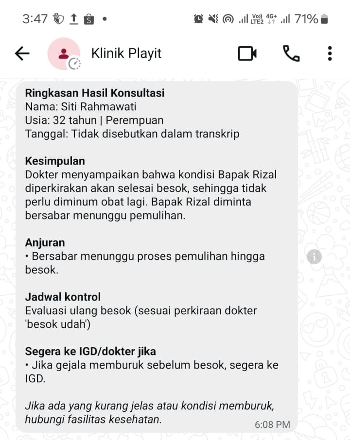

# VeriScribe (PlayItPlus)

**Asisten AI dokumentasi klinis berbasis verifikasi dokter, dengan ringkasan pasien yang konsisten.**

VeriScribe membantu dokter rawat jalan mengubah percakapan konsultasi menjadi dua keluaran yang tervalidasi dari satu proses:

1. **Draf catatan klinis terstruktur (SOAP)** untuk tenaga kesehatan, dan
2. **Ringkasan tindak lanjut berbahasa sehari-hari** untuk pasien.

Nama **VeriScribe** adalah judul proposal proyek ini; **PlayItPlus** adalah nama purwarupa yang berjalan (demo: https://playitplus.vercel.app/). Konsep lengkap terdapat di `docs/KONSEP_PROYEK.md`.

> **Ringkasnya:** dokter berfokus pada percakapan dengan pasien sebagaimana konsultasi pada umumnya. VeriScribe mendengarkan percakapan tersebut, menyusun draf catatannya, dan menyiapkan ringkasan untuk pasien. Dokter kemudian memeriksa draf tersebut, memperbaikinya apabila diperlukan, dan mengesahkannya.

> **Tentang proyek ini:** VeriScribe dikembangkan untuk **lomba PLAY IT Hackathon DeepTech 2026 (PlayItPlus)**, kategori Digitalisasi AI Bidang Kesehatan.
>
> **Status demo — mohon diperhatikan:** sistem ini **bekerja 100%** dari ujung ke ujung (rekam → transkrip → deidentifikasi → draf SOAP → ringkasan pasien) selama API key LLM/STT terpasang. Saat ini **API key LLM pada demo yang terpasang telah dicabut karena alasan biaya**, sehingga demo publik di https://playitplus.vercel.app/ tidak memanggil AI yang sebenarnya sampai key dipasang kembali. Hal ini murni berkaitan dengan biaya pemakaian, bukan karena sistem belum selesai: untuk menjalankannya secara penuh, silakan mengisi API key Anda pada `backend/.env` (lihat bagian Konfigurasi Backend), atau jalankan mode `mock` untuk melihat alurnya tanpa key.

> Prinsip yang tidak berubah: **AI membantu dokumentasi. Keputusan klinis tetap berada pada dokter.** Sistem tidak menetapkan diagnosis, tidak meresepkan obat, dan tidak menggantikan keputusan dokter. Draf AI bersifat usulan — final hanya setelah dokter memeriksa, mengoreksi, dan mengesahkannya.


*Ilustrasi konsep: kondisi saat ini (kiri) dibandingkan dengan alur yang ditawarkan VeriScribe (kanan).*

## Tujuan Kami

Dalam satu konsultasi di klinik atau puskesmas, dokter menjalankan dua pekerjaan dalam waktu yang bersamaan: mendengarkan dan memeriksa pasien, **serta** menulis catatan hasil pemeriksaan. Akibatnya, sebagian waktu dokter habis untuk menulis, bukan untuk pasien. Sebaliknya, pasien pulang hanya mengandalkan ingatan: obat apa yang harus diminum, bagaimana aturan pakainya, dan kapan harus kontrol kembali — semuanya mudah terlupakan setibanya di rumah.

Tujuan kami mengembangkan VeriScribe ada tiga, dan ketiganya berangkat dari satu percakapan yang sama:

1. **Dokter dapat berfokus pada pasien, bukan pada penulisan catatan.** Penulisan catatan dibantu AI, sehingga waktu konsultasi digunakan untuk berbicara dan memeriksa. Dokter tidak perlu lagi menulis ulang hal yang sama berulang kali.
2. **Catatan yang dihasilkan rapi dan dapat dipercaya.** Seluruh catatan menggunakan format yang sama, dan setiap isinya dapat diperiksa kembali terhadap ucapan aslinya dalam percakapan. AI tidak mengarang: apabila sesuatu tidak dibicarakan, bagian tersebut ditandai sebagai kosong, bukan diisi dengan tebakan. Keputusan terakhir tetap berada di tangan dokter — catatan baru resmi setelah dokter mengesahkannya.
3. **Pasien pulang dengan panduan yang jelas, bukan sekadar ingatan.** Pasien menerima ringkasan dalam bahasa sehari-hari: obat yang diberikan, cara meminumnya, anjuran yang perlu dijalankan, dan jadwal kontrol berikutnya. Isinya sama persis dengan yang diputuskan dokter, karena ringkasan tersebut dibuat dari catatan yang telah disahkan dokter — sehingga kemungkinan pasien salah ingat atau salah memahami instruksi menjadi jauh lebih kecil.

Apabila ketiga hal ini tercapai, manfaatnya dirasakan tidak hanya oleh dokter dan pasien: fasilitas kesehatan juga memperoleh catatan yang seragam dan rapi dari seluruh dokternya, tanpa menambah beban pekerjaan siapa pun. Itulah tujuan akhirnya — **satu konsultasi selesai, dua kebutuhan terpenuhi: dokter memiliki catatan yang sah, pasien memiliki panduan yang jelas.**

## Masalah yang Diselesaikan

Dua masalah muncul pada kejadian yang sama, yaitu konsultasi rawat jalan:

- **Di sisi dokter — beban dokumentasi.** Dokter mencatat anamnesis secara manual sehingga waktu konsultasi terpakai untuk menulis, dan format catatan antar dokter tidak seragam. Studi observasional pada 57 dokter rawat jalan menemukan 49,2% waktu kerja digunakan untuk rekam kesehatan elektronik dan pekerjaan meja, dan 37,0% waktu di ruang pemeriksaan dipakai untuk pekerjaan tersebut [3]. Cara mengukur beban ini sendiri belum seragam di literatur [1]. Karena dokter tetap bertanggung jawab atas isi rekam medis, catatan otomatis yang tidak dapat ditelusuri sumbernya justru menambah pekerjaan verifikasi.
- **Di sisi pasien — instruksi mudah terlupakan.** Pasien keluar dari ruang periksa membawa instruksi lisan yang mudah terlupakan. Pada studi di instalasi gawat darurat, lembar instruksi yang panjang membuat pasien sulit menemukan informasi obat dan jadwal kontrol, dan ringkasan satu halaman meningkatkan pemahaman mereka [2].

Rumusan masalahnya: *bagaimana membantu dokter mengubah percakapan konsultasi menjadi catatan klinis yang terstruktur dan mudah diperiksa, sekaligus menghasilkan instruksi tindak lanjut yang konsisten bagi pasien, tanpa mengambil alih keputusan dokter?*

Pengguna utamanya adalah dokter rawat jalan; penerima ringkasannya adalah pasien atau pendamping yang diberi izin; calon pembelinya adalah fasilitas kesehatan.

## Cara Kerja

1. **Rekam dengan persetujuan.** Percakapan dokter–pasien direkam setelah pasien menyetujui, lalu diubah menjadi transkrip.
2. **Identitas dilindungi.** Transkrip melewati deidentifikasi PII sebelum diproses lebih lanjut.
3. **AI menyusun draf SOAP.** Setiap butir catatan **ditautkan ke kutipan percakapan** sebagai sumbernya. Bagian yang tidak disebutkan, disangkal (negasi), atau ambigu **diberi tanda khusus**, sehingga ketiadaan data tidak terbaca sebagai hasil pemeriksaan normal.
4. **Dokter memeriksa dan mengesahkan.** Dokter mengoreksi dan mengesahkan catatan sebelum disimpan ke sistem rekam medis fasilitas melalui jalur integrasi yang disepakati.
5. **Ringkasan pasien dibuat dari catatan yang disahkan** — bukan dari transkrip — sehingga instruksi pasien tidak menyimpang dari keputusan klinis. Isinya adalah instruksi obat, anjuran, dan jadwal kontrol yang memang diberikan. Apabila catatan berubah, ringkasan diperbarui dan diperiksa ulang. Pengiriman melalui WhatsApp (dengan persetujuan pasien dan verifikasi penerima) merupakan tahap pengembangan berikutnya; pada purwarupa ini pengirimannya disimulasikan.

Alur inti backend: Audio → STT → Deidentifikasi PII → Auto-fill SOAP (dengan kutipan sumber + penanda ketidakpastian).



*Contoh tampilan ringkasan tindak lanjut pasien sebagaimana diterima melalui WhatsApp (simulasi purwarupa, data contoh).*

## Keunggulan

Transkripsi, draf SOAP, dan ringkasan pasien telah tersedia pada berbagai produk. Keunggulan VeriScribe terletak pada rantai yang dijaga dari awal sampai akhir:

- **Keterlacakan fakta.** Setiap fakta dalam catatan dapat dilacak kembali ke kutipan percakapannya; fakta tanpa sumber terlihat jelas dan dapat dihapus oleh dokter saat verifikasi.
- **Negasi dan ketidakpastian ditandai, bukan ditebak.** Hal yang tidak disebutkan atau disangkal pasien tidak pernah ditulis seolah-olah merupakan temuan normal.
- **Ringkasan pasien selalu konsisten.** Satu-satunya sumber ringkasan adalah catatan yang telah disahkan dokter, bukan transkrip mentah dan bukan hasil karangan model.
- **Kendali akhir berada pada dokter.** Tidak ada keluaran yang menjadi final atau terkirim sebelum disahkan.
- **Provider-agnostik.** Backend berkomunikasi melalui antarmuka OpenAI-compatible; penggantian vendor LLM/STT cukup dilakukan melalui env, tanpa mengubah kode, dan tanpa fallback tersembunyi.

## Status dan Indikator Pengukuran

- **Konteks:** proyek lomba PLAY IT Hackathon DeepTech 2026 (PlayItPlus), kategori Digitalisasi AI Bidang Kesehatan.
- **Kondisi demo saat ini:** seluruh alur berfungsi 100% apabila API key LLM/STT terpasang; API key LLM pada demo publik telah dicabut karena biaya, sehingga demo berjalan tanpa panggilan AI yang sebenarnya sampai key dipasang kembali.
- **Tingkat kesiapan teknologi:** TKT 2 menuju TKT 3. Konsep telah dirumuskan dan didukung literatur [1][2][3]; tahap berikutnya adalah pembuktian fungsi inti pada konsultasi simulasi.
- **Batasan purwarupa:** satu alur konsultasi rawat jalan dan satu format catatan. Pengiriman WhatsApp masih berupa simulasi.
- **Indikator pengujian:** waktu dokumentasi total (termasuk waktu koreksi draf), kelengkapan informasi, kesalahan pada negasi dan rincian obat, jumlah fakta tanpa sumber, konsistensi ringkasan terhadap catatan yang disahkan, dan kemampuan pasien mengulang instruksi.
- **Target awal:** waktu dokumentasi total lebih rendah daripada pencatatan manual, dengan kesalahan klinis yang tidak meningkat. Manfaat ini merupakan sasaran pengujian, bukan hasil yang sudah terbukti.
- **Hilirisasi:** pilot di satu fasilitas layanan primer dengan satu alur rawat jalan, lalu diperluas ke fasilitas lain yang memiliki alur serupa. Model bisnis yang dipertimbangkan: langganan per fasilitas atau per dokter. Dukungan mitra formal belum dimiliki pada tahap ini; kerja sama pilot terbuka.

## Tim Pelaksana

| Nama | Peran |
|---|---|
| Dr. Ely Setyo Astuti, ST., MT. | Project Lead & Clinical Quality Advisor |
| I Nyoman Darma Kotama, S.T., M.T. | AI Architecture & Product Strategy Lead |
| Fahri Zanuar Pradian | AI & Software Engineer |
| Rizal Abrar Fahmi | Data Specialist & Software Engineer |

## Struktur

- `frontend/` — Next.js 16 + React 19 + Tailwind v4 (port 3000)
- `backend/` — Elysia + Bun (port 3001). Provider agnostik vendor melalui antarmuka OpenAI-compatible (`LLM_*` / `STT_*`), tanpa fallback tersembunyi
- `docs/` — konsep proyek dan jurnal riset, serta ilustrasi konsep (`konsep-dua-keluaran.png`) dan contoh ringkasan pasien (`contoh-ringkasan-whatsapp.jpg`)

## Prasyarat

- `bun@1.4.2`

## Cara Menjalankan

```bash
# 1. Siapkan env backend
cp backend/.env.example backend/.env

# 2. Pasang dependency
bun install --cwd frontend
bun install --cwd backend

# 3. Jalankan mode pengembangan (dari root)
bun run:backend    # http://localhost:3001
bun run:frontend   # http://localhost:3000
```

Build dan pemeriksaan:

```bash
bun build:backend
bun build:frontend
bun validate:lg        # validasi kelas Tailwind desktop (frontend)
bun lint:frontend      # eslint frontend
```

## Konfigurasi Backend (`backend/.env`)

| Key | Isi |
|---|---|
| `PORT`, `CORS_ORIGIN` | Wajib. Server gagal dijalankan apabila kosong atau salah |
| `LLM_PROVIDER`, `STT_PROVIDER` | Hanya `mock` atau `unified`. Kesalahan penulisan langsung menyebabkan kegagalan saat server dinyalakan |
| `LLM_*` / `STT_*` (`API_KEY`, `BASE_URL`, `MODEL`) | Wajib diisi saat mode `unified`. Contoh `BASE_URL`: OpenRouter `https://openrouter.ai/api/v1`, Groq `https://api.groq.com/openai/v1`, Ollama `http://localhost:11434/v1` |

Mode `mock` digunakan untuk demo offline. Mode `unified` memanggil endpoint OpenAI-compatible sesuai `BASE_URL` — penggantian vendor cukup dilakukan melalui env, tanpa mengubah kode.

## Endpoint Backend

- `GET /` — informasi API
- `GET /api/consultation/samples` — contoh transkrip untuk pengujian
- `GET /api/consultation/status` — provider aktif (tanpa menampilkan key)
- `POST /api/consultation/stt` — `audio` (file) → transkrip
- `POST /api/consultation/deidentify` — `text` → teks teranonimasi + entitas PII
- `POST /api/consultation/autofill` — `text` → SOAP
- `POST /api/consultation/process` — `audio` atau `text` → pipeline lengkap

## Referensi

[1] Moy, A. J., dkk. “Measurement of clinical documentation burden among physicians and nurses using electronic health records: a scoping review.” *Journal of the American Medical Informatics Association*, 28(5), 998–1008, 2021. https://doi.org/10.1093/jamia/ocaa325

[2] DeSai, C., dkk. “Empowering patients: simplifying discharge instructions.” *BMJ Open Quality*, 10, e001419, 2021. https://doi.org/10.1136/bmjoq-2021-001419

[3] Sinsky, C., dkk. “Allocation of Physician Time in Ambulatory Practice: A Time and Motion Study in 4 Specialties.” *Annals of Internal Medicine*, 165(11), 753–760, 2016. https://doi.org/10.7326/M16-0961
