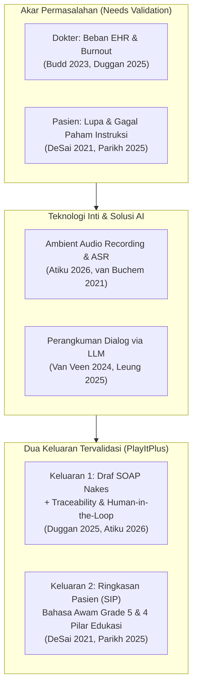

# Ringkasan Eksekutif & Analisis Relevansi Jurnal Ilmiah Pendukung PlayItPlus

Dokumen ini menyajikan rangkuman komprehensif dari 8 jurnal/makalah ilmiah yang tersimpan di direktori `docs/journal/`, serta memetakan keterkaitannya secara rinci dengan dokumen [KONSEP_PROYEK.md](file:///D:/playitplus/docs/KONSEP_PROYEK.md) (*Asisten Dokumentasi Konsultasi dan Ringkasan Tindak Lanjut Pasien Berbasis AI*).

---

## 1. Peta Keselarasan Jurnal dengan Konsep Proyek

Seluruh 8 jurnal saling melengkapi dan secara utuh menopang prinsip utama proyek:
> **"Satu konsultasi, dua keluaran tervalidasi: catatan klinis terstruktur untuk tenaga kesehatan dan panduan tindak lanjut yang mudah dipahami pasien."**

| No | File Jurnal | Fokus Utama | Domain Relevansi dalam `KONSEP_PROYEK.md` | Derajat Relevansi |
|---|---|---|---|---|
| 1 | `burnout related to electronic health record use in primary care.pdf` (Budd, 2023) | Burnout dokter akibat beban administratif EHR & usability buruk. | **Bab 1, 2.1, 4.3**: Justifikasi masalah beban dokumentasi manual dan dasar kebutuhan EHR assistant. | ⭐️⭐️⭐️⭐️⭐️ (Fondasi Masalah) |
| 2 | `Clinician Experiences With Ambient Scribe Technology.pdf` (Duggan et al., 2025) | Uji coba klinis nyata ambient AI scribe (DAX Copilot) di 17 spesialisasi rawat jalan. | **Bab 4.3, 7, 9.1, 14.3**: Bukti efisiensi (hemat 20.4% waktu, pangkas 30% *pajama time*) & peringatan *note bloat*. | ⭐️⭐️⭐️⭐️⭐️ (Bukti Empiris Alur Nakes) |
| 3 | `The digital scribe in clinical practice a scoping review and.pdf` (van Buchem et al., 2021) | Scoping review arsitektur digital scribe (ASR + NLP) & roadmap riset 4 fase. | **Bab 6.2, 10.1, 14.3, 16**: Kerangka rancangan sistem teknis & metodologi evaluasi bertahap (Suitability → Utility). | ⭐️⭐️⭐️⭐️⭐️ (Fondasi Arsitektur Sistem) |
| 4 | `AI Scribes in Health Care Balancing Transformative Potential.pdf` (Leung et al., 2025) | Analisis lanskap terkini, peluang, serta risiko medicolegal & *cognitive debt*. | **Bab 6.3, 12, 13, 15**: Panduan tata kelola, bias otomatisasi, perlunya pengawasan manusia, & ringkasan pasien. | ⭐️⭐️⭐️⭐️⭐️ (Tata Kelola & Diferensiasi) |
| 5 | `Assessing the Reliability, Accuracy, and Relevance of.pdf` (Atiku et al., 2026) | Evaluasi sistematis akurasi & kegagalan ASR medis di berbagai faskes. | **Bab 6.4, 12.1, 14.3, 15**: Bukti kerentanan ASR pada kata seru/NLCS (>90% eror), negasi, dosis, & alasan sistem harus asisitif. | ⭐️⭐️⭐️⭐️⭐️ (Keselamatan Klinis & Mitigasi ASR) |
| 6 | `Adapted Large Language Models Can Outperform.pdf` (Van Veen et al., 2024) | Adaptasi LLM untuk perangkuman teks klinis (dialog dokter-pasien, progress notes). | **Bab 6.2, 8.1, 10.2, 14.3**: Metode adaptasi (ICL vs QLoRA), mitigasi 3 jenis fabrikasi, metrik MEDCON vs BLEU. | ⭐️⭐️⭐️⭐️⭐️ (DeepTech LLM & Perangkuman Dialog) |
| 7 | `Empowering patients simplifying.pdf` (DeSai et al., 2021) | Peningkatan pemahaman pasien melalui *Simplified Information Page* (SIP) 1 halaman. | **Bab 1, 6.1, 8.2, 8.3, 14.3**: Standar desain keluaran ringkasan pasien (Flesch-Kincaid Grade 5, piktogram, 1 halaman). | ⭐️⭐️⭐️⭐️⭐️ (Desain Keluaran Pasien / SIP) |
| 8 | `Enhancing Patient Understanding of Hospitalization.pdf` (Parikh et al., 2025) | Uji komunikasi dokter-pasien & teach-back menggunakan ringkasan tertulis 1 halaman. | **Bab 2.2, 8.2, 14.3**: 4 domain krusial pemahaman pasien (Diagnosis, Tindakan, Obat, Kontrol) & validasi hipotesis pasien. | ⭐️⭐️⭐️⭐️⭐️ (Validasi Pemahaman Pasien) |

---

## 2. Rangkuman Detail Masing-Masing Jurnal

---

### Jurnal 1: Burnout Related to Electronic Health Record Use in Primary Care
- **Penulis**: Jeffrey Budd, MD (University of Florida College of Medicine)
- **Publikasi**: *Journal of Primary Care & Community Health*, Vol. 14, 2023. DOI: `10.1177/21501319231166921`
- **File**: `burnout related to electronic health record use in primary care.pdf`

#### Intisari Penelitian
Artikel ulasan literatur PubMed ini mengidentifikasi faktor pemicu kelelahan kerja (*burnout*) dokter akibat penggunaan Rekam Medis Elektronik (EHR/EMR). Dokter layanan primer menghabiskan **hampir 50% hari kerja klinis** untuk dokumentasi EHR dan pekerjaan meja, serta hanya sekitar **27% untuk interaksi langsung tatap muka dengan pasien**. Dokter membutuhkan rata-rata **2 jam entri data EHR untuk setiap 1 jam kontak pasien**.

Faktor utama pemicu burnout:
1. **Beban Administratif & Klerikal**: 69% dokter layanan primer merasa tugas klerikal EHR tidak memerlukan kompetensi dokter. Panjang catatan medis meningkat dua kali lipat sejak regulasi HITECH Act (2009).
2. **Usability Sangat Rendah**: Skor *System Usability Scale* (SUS) EHR secara keseluruhan hanya **45.9** (Grade **F**, masuk dalam persentil 9% terbawah dari semua teknologi perangkat lunak).
3. **Beban Kognitif Tinggi**: Kelebihan informasi (*information overload*), antarmuka terfragmentasi, dan banjir peringatan (*alert fatigue* — rata-rata 56.4 *alert* per hari, memakan waktu 49 menit).
4. **Waktu Lembur Rumah (*Pajama Time*)**: Sekitar 63% dokter mengeluhkan terganggunya *work-life balance*. Dokter yang menghabiskan waktu EHR di rumah >5-6 jam per minggu berisiko 2.43 kali lipat mengalami burnout.

#### Relevansi dengan Konsep Proyek PlayItPlus
- **Memperkuat Latar Belakang (Bab 1 & 2.1)**: Memberikan rujukan akademik kuantitatif yang kuat bahwa beban dokumentasi bukan sekadar keluhan subjektif, melainkan krisis operasional kesehatan yang terbukti secara literatur.
- **Validasi Metrik Evaluasi (Bab 14.3)**: Mendukung pemilihan indikator efisiensi dokumentasi (*pajama time*, waktu entri data, kemudahan antarmuka).

---

### Jurnal 2: Clinician Experiences With Ambient Scribe Technology to Assist With Documentation Burden and Efficiency
- **Penulis**: Matthew J. Duggan, Julietta Gervase, Anna Schoenbaum, William Hanson, John T. Howell III, Michael Sheinberg, Kevin B. Johnson (University of Pennsylvania Health System)
- **Publikasi**: *JAMA Network Open*, 2025; 8(2):e2460637. DOI: `10.1001/jamanetworkopen.2024.60637`
- **File**: `Clinician Experiences With Ambient Scribe Technology.pdf`

#### Intisari Penelitian
Studi *quality improvement* prospektif *pre-post* pada 46 klinisi di 17 spesialisasi medis (rawat jalan Penn Medicine) yang menguji alat perekam *ambient AI scribe* komersial (**DAX Copilot** dari Nuance/Microsoft) yang terintegrasi langsung dengan EHR Epic (aplikasi mobile Haiku).

Temuan Kunci:
1. **Efisiensi Waktu Dokumentasi**: Waktu pencatatan per janji temu turun **20.4%** (dari 10.3 menit menjadi 8.2 menit, $P < 0.001$).
2. **Penutupan Kunjungan Hari yang Sama**: Meningkat **9.3%** (dari 66.2% menjadi 72.4%, $P < 0.001$).
3. **Pengurangan Waktu Lembur (*Pajama Time*)**: Turun **30.0%** (dari 50.6 menit menjadi 35.4 menit per hari kerja, $P = 0.02$).
4. **Pengetikan Manual**: Berkurang **29.6%** (dari 11.2% menjadi 7.9% karakter yang diketik langsung, $P < 0.001$).
5. **Keterlibatan Pasien & Mental**: Klinisi merasa lebih fokus menatap pasien tanpa terhalang layar komputer, serta penurunan signifikan rasa lelah kognitif.
6. **Peringatan & Batasan**: 
   - Muncul fenomena ***note bloat***: total karakter catatan mingguan justru bertambah **20.6%** karena teks AI cenderung panjang.
   - Klinisi menegaskan alat ini **bukan pengalaman tanpa keyboard (*not a keyboardless experience*)**; dokter tetap harus melakukan peninjauan (*proofreading*) dan koreksi (bagian subjektif benar 80–85%, namun bagian objektif & asesmen masih perlu penyesuaian).

#### Relevansi dengan Konsep Proyek PlayItPlus
- **Kesesuaian Arsitektur Alur Kerja (Bab 7 & 10)**: Membuktikan kelayakan integrasi ambient recording via smartphone/mikrofon ke alur kunjungan poliklinik rawat jalan.
- **Konfirmasi Batasan & Prinsip Pengesahan (Bab 6.3 & 12.1)**: Menjadi bukti lapangan bahwa AI tidak boleh langsung memfinalisasi rekam medis; *human-in-the-loop* mutlak diperlukan untuk mencegah kesalahan hukum dan klerikal.
- **Antisipasi *Note Bloat* (Bab 8.1 & 13)**: PlayItPlus harus menerapkan pembatasan panjang teks dan ringkasan terfokus agar tidak memperparah inflasi catatan medis.

---

### Jurnal 3: The Digital Scribe in Clinical Practice: A Scoping Review and Research Agenda
- **Penulis**: Marieke M. van Buchem, Hileen Boosman, Martijn P. Bauer, Ilse M. J. Kant, Simone A. Cammel, Ewout W. Steyerberg (Leiden University Medical Center)
- **Publikasi**: *npj Digital Medicine* (Nature Portfolio), 2021; 4:57. DOI: `10.1038/s41746-021-00432-5`
- **File**: `The digital scribe in clinical practice a scoping review and.pdf`

#### Intisari Penelitian
Scoping review terhadap 20 makalah dan analisis industri mengenai evolusi *digital scribe* yang menggabungkan *Automatic Speech Recognition* (ASR) dan *Natural Language Processing* (NLP) untuk merangkum percakapan klinis non-linear dan terfragmentasi.

Temuan Kunci:
1. **Empat Fase Riset Digital Scribe (Box 1)**:
   - *Fase 1: Kesesuaian (Suitability)* — Perumusan masalah, penentuan output yang dibutuhkan, dataset representatif, dan *ground truth*.
   - *Fase 2: Validitas Teknis (Technical Validity)* — Akurasi model (ASR Word Error Rate, NLP F1-score/ROUGE).
   - *Fase 3: Validitas Klinis dan Usabilitas (Clinical Validity & Usability)* — Evaluasi kualitatif nakes apakah catatan masuk akal dan sesuai konteks klinis.
   - *Fase 4: Utilitas Klinis (Clinical Utility)* — Uji prospektif di alur pelayanan nyata terhadap waktu, biaya, dan keselamatan.
2. **Kesenjangan Kritis**: Sebagian besar penelitian hanya berfokus pada validitas teknis terisolasi, sementara solusi komersial sering melompati evaluasi usabilitas klinis dan keamanan.
3. **Teknologi NLP**: Model *sequence-to-sequence* dengan mekanisme atensi (*attention layer*) dan *pointer-generator networks* (PGNet) terbukti paling efektif karena menyalin fakta langsung dari transkrip percakapan guna meminimalkan halusinasi.

#### Relevansi dengan Konsep Proyek PlayItPlus
- **Pedoman Tahapan Pengembangan (Bab 16)**: Fase 1 s.d. 4 dari makalah ini menjadi kerangka acuan metodologis langsung untuk Tahap 1 (Penyelarasan Masalah) hingga Tahap 5 (Kesiapan Pilot) PlayItPlus.
- **Rancangan Teknis NLP (Bab 10.1 & 10.2)**: Menggarisbawahi pentingnya model yang mengutamakan penyalinan berbasis bukti percakapan (*extractive-abstractive hybrid*) dibanding generasi teks bebas yang rawan fabrikasi.

---

### Jurnal 4: AI Scribes in Health Care: Balancing Transformative Potential With Responsible Integration
- **Penulis**: Tiffany I Leung, Andrew J Coristine, Arriel Benis
- **Publikasi**: *JMIR Medical Informatics*, 2025; 13:e80898. DOI: `10.2196/80898`
- **File**: `AI Scribes in Health Care Balancing Transformative Potential.pdf`

#### Intisari Penelitian
Editorial komprehensif yang mengkaji ledakan adopsi ambient AI scribe berbasis Large Language Model (LLM) serta tantangan implementasi yang bertanggung jawab.

Temuan Kunci:
1. **Evolusi Sistem Dokumentasi (Coiera et al.)**:
   - Tahap 1: Sistem dipimpin manusia (*human-led*) dibantu dikte/templat.
   - Tahap 2: Sistem inisiatif bersama (*mixed-initiative*), di mana AI mengonversi percakapan menjadi draf ringkasan. (Posisi teknologi saat ini).
   - Tahap 3: Sistem otonom komputer (*computer-led*) dengan manusia hanya menangani pengecualian.
2. **Risiko & Tantangan Baru**:
   - ***Cognitive Debt***: Ketergantungan berlebihan pada AI dapat menurunkan daya ingat klinis dan ketajaman berpikir kritis dokter/residen.
   - *Automation Bias*: Kecenderungan dokter menerima draf AI tanpa verifikasi mendalam.
   - *Hallucination & Omission*: Kelalaian mencatat hal krusial atau menciptakan informasi fiktif.
   - *Medicolegal & Privacy*: Akses data sensitif, keamanan transmisi, dan tanggung jawab hukum malpraktik.
3. **Peluang yang Belum Tergarap (*Unexplored Gap*)**: Sebagian besar studi hanya mengevaluasi persepsi dokter. Riset sangat minim mengenai **sudut pandang pasien/keluarga** dan pemanfaatan AI scribe untuk menghasilkan ringkasan kunjungan yang ramah pasien (*patient-friendly visit summaries*).

#### Relevansi dengan Konsep Proyek PlayItPlus
- **Landasan Posisi Inovasi & Nilai Pembeda (Bab 13)**: Menegaskan bahwa diferensiasi PlayItPlus ("dua keluaran: catatan klinis dokter + panduan pasien") menjawab langsung celah riset global (*patient-centered ambient scribe*).
- **Tata Kelola & Keselamatan (Bab 12.1 & 12.3)**: Menjadi justifikasi mengapa persetujuan (*informed consent*), retensi data audio terbatas, dan verifikasi dokter mutlak wajib diterapkan.

---

### Jurnal 5: Assessing the Reliability, Accuracy, and Relevance of Artificial Intelligence Speech Recognition for Clinical Documentation: A Scoping Review
- **Penulis**: Samuel Atiku, Kehinde Owolanke, Olufisayo Olakotan
- **Publikasi**: *Journal of Evaluation in Clinical Practice*, 2026; 32:e70460. DOI: `10.1111/jep.70460`
- **File**: `Assessing the Reliability, Accuracy, and Relevance of.pdf`

#### Intisari Penelitian
Scoping review terhadap 32 studi (2008–2025) mengenai reliabilitas, akurasi, dan keselamatan Speech Recognition (ASR) dalam dokumentasi klinis di berbagai setting (UGD, rawat jalan, radiologi, psikiatri).

Temuan Kunci:
1. **Tingkat Kesalahan Lapangan Sangat Tinggi**: Dalam kondisi percakapan nyata non-dikte (spontan, berisik), tingkat eror transkripsi melonjak drastis: hingga **71% catatan UGD** mengandung minimal 1 kesalahan, dan **15% merupakan kesalahan kritis** yang membahayakan pasien.
2. **Kegagalan Menangkap Kata Seru & Respons Singkat**: Kata percakapan non-leksikal (NLCS) seperti *"mm-hm"* (ya) dan *"uh-uh"* (tidak) mengalami **kegagalan pengenalan >90%** pada mesin ASR komersial.
3. **Kerentanan Klinis Kritis**: ASR sangat rentan salah pada:
   - Negasi (misal *"no history of..."* tertranskripsi *"history of..."*).
   - Lateralitas (*left* vs *right*).
   - Nama obat (misal *metoprolol succinate* hampir tidak pernah tertranskripsi tepat).
   - Angka/dosis dan istilah medis singkatan.
4. **Beban Pengeditan (*Editing Burden*)**: AI mempercepat pembuatan draf, tetapi menggeser beban kerja dokter ke proses verifikasi dan audit kata-demi-kata.

#### Relevansi dengan Konsep Proyek PlayItPlus
- **Pengelolaan Ketidakpastian & Negasi (Bab 6.4 & 12.1)**: Menjadi landasan kuat mengapa PlayItPlus wajib memiliki logika eksplisit untuk membedakan *tidak disebutkan*, *disangkal (negasi)*, *ambigu*, dan *perlu konfirmasi*.
- **Keterlacakan Sumber (*Traceability*) (Bab 4.2 & 9.1)**: Membuktikan bahwa fitur PlayItPlus yang menampilkan kutipan sumber transkrip pada setiap klaim draf SOAP sangat krusial untuk mempercepat audit dokter tanpa membaca ulang seluruh teks.

---

### Jurnal 6: Adapted Large Language Models Can Outperform Medical Experts in Clinical Text Summarization
- **Penulis**: Dave Van Veen, Cara Van Uden, Louis Blankemeier, Jean-Benoit Delbrouck, Curtis P. Langlotz, Jason Hom, Akshay S. Chaudhari, et al. (Stanford University)
- **Publikasi**: *Nature Medicine* / arXiv:2309.07430v5 [cs.CL], April 2024.
- **File**: `Adapted Large Language Models Can Outperform.pdf`

#### Intisari Penelitian
Studi eksperimental dari Stanford University yang mengevaluasi 8 LLM (open-source & proprietary: GPT-4, GPT-3.5, Llama-2, FLAN-T5, Med-Alpaca, dll.) pada 4 tugas perangkuman teks klinis (laporan radiologi, pertanyaan pasien MeQSum, progress notes ProbSum, dan dialog dokter-pasien **ACI-Bench**).

Temuan Kunci:
1. **Evaluasi Dokter Buta Ganda (*Reader Study*)**: 10 dokter spesialis menilai draf perangkuman. Hasilnya: draf dari LLM terbaik (GPT-4 dengan In-Context Learning) dinilai **setara (45%) atau lebih unggul (36%)** dibanding ringkasan yang dibuat oleh dokter ahli (hanya 19% ringkasan manusia yang lebih disukai).
2. **Karakteristik Keunggulan**: LLM lebih unggul dalam *kelengkapan (completeness)* dan *keringkasan (conciseness)* serta menghindari kekeliruan detail lateralitas.
3. **Taksonomi Fabrikasi Informasi Klinis**:
   - *Misinterpretations of ambiguity* (salah menafsirkan ucapan ambigu): LLM 6% vs Manusia 9%.
   - *Factual inaccuracies* (mengubah fakta yang ada): LLM 2% vs Manusia 4%.
   - *Hallucinations* (mengarang fakta baru tanpa dasar teks): LLM 5% vs Manusia 12%.
   *(Fakta mengejutkan: dokter manusia juga kerap "berhalusinasi" karena salah mengingat isi konsultasi!)*
4. **Strategi Adaptasi & Parameter**:
   - Suhu model (*temperature*) rendah ($0.1$) memberikan performa terbaik untuk menjaga kepatuhan fakta.
   - *In-Context Learning (ICL)* dengan contoh relevan berbasis *nearest-neighbor* melampaui teknik fine-tuning (QLoRA) ketika panjang konteks mencukupi.
   - Metrik NLP standar (BLEU/ROUGE) berkorelasi rendah dengan penilaian klinis manusia; metrik semantik (*BERTScore*) dan konsep medis (*MEDCON/QuickUMLS*) jauh lebih berkorelasi dengan ketepatan (*correctness*).

#### Relevansi dengan Konsep Proyek PlayItPlus
- **Perumusan Prompting & Ekstraksi SOAP (Bab 10.2 & 14.2)**: Panduan empiris penyusunan prompt ekstraksi dialog konsultasi ke draf SOAP: wajib gunakan role spesifik (*medical expert*), batasan panjang tegas, dan temperature $0.1$.
- **Mitigasi Halusinasi & Bahaya Klinis (Bab 12.1 & 15)**: Klasifikasi 3 jenis fabrikasi Van Veen menjadi dasar penyusunan rubrik pengujian keselamatan PlayItPlus.
- **DeepTech Benchmarking (Bab 13 & 14.3)**: Mengadopsi dataset ACI-Bench dan metrik konsistensi konsep medis (*MEDCON/UMLS*) untuk memperkuat pembuktian ilmiah pada kompetisi hackathon.

---

### Jurnal 7: Empowering Patients: Simplifying Discharge Instructions
- **Penulis**: Charisma DeSai, Keri Janowiak, Beatrice Secheli, Eleanor Phelps, Sam McDonald, Gary Reed, Andra Blomkalns (UT Southwestern & Stanford University)
- **Publikasi**: *BMJ Open Quality*, 2021; 10:e001419. DOI: `10.1136/bmjoq-2021-001419`
- **File**: `Empowering patients simplifying.pdf`

#### Intisari Penelitian
Proyek peningkatan mutu klinis (*Quality Improvement*) di Clements University Hospital ED yang menangani masalah ketidakpahaman pasien terhadap instruksi tindak lanjut pasca-pelayanan.

Temuan Kunci:
1. **Kegagalan Lembar Instruksi Standar**:
   - Berkas instruksi standar tebal (6 hingga 22 halaman), bertele-tele, dan membingungkan.
   - **Sekitar 50% (58/118) pasien sama sekali tidak membaca atau merujuk berkas instruksi mereka**.
   - Pada baseline, **0% (tidak ada satu pun) pasien yang memiliki pemahaman utuh** terhadap instruksinya. Dua area dengan nilai terendah: aturan minum obat (dosis & durasi, 80% gagal paham) dan indikasi kapan harus kembali ke UGD/tanda bahaya (79% gagal paham).
2. **Intervensi *Simplified Information Page* (SIP)**:
   - Dibuat ringkasan **1 halaman padat** dengan bahasa awam setara tingkat membaca kelas 5 SD (*Flesch-Kincaid Grade 5*).
   - Memanfaatkan ruang putih (*white space*), huruf besar, dan **piktogram visual** (gambar kapsul obat, kalender kontrol, tanda palang darurat untuk gejala bahaya).
3. **Hasil Intervensi**: Skor komposit pemahaman pasien melonjak signifikan sebesar **22%** ($P < 0.001$, dari median 4.5 menjadi 5.5). Tidak ada pasien yang mendapat skor di bawah 3 pasca-intervensi.

#### Relevansi dengan Konsep Proyek PlayItPlus
- **Format Keluaran Ringkasan Pasien (Bab 8.2 & 8.3)**: Memberikan acuan langsung bentuk pesan WhatsApp / ringkasan PlayItPlus: ringkas, padat, bahasa awam grade 5, dan terstruktur jelas.
- **Poin Kritis yang Wajib Ada**: Wajib menonjolkan (1) Aturan obat, (2) Kapan harus segera kembali / *red flags*, dan (3) Jadwal kontrol.

---

### Jurnal 8: Enhancing Patient Understanding of Hospitalization and Post-Discharge Needs: The Impact of Physician-Led Verbal Communication and Teach-Back Method
- **Penulis**: Payal Parikh, Priya Jaisinghani, Srivarsha Kaloth, Anagha Konakanchi, Naveena Yanamala, Sarang Kim (Rutgers Robert Wood Johnson Medical School & NYU Grossman)
- **Publikasi**: *Journal of General Internal Medicine* (JGIM), 2025; 40(9):2103–2110. DOI: `10.1007/s11606-025-09510-w`
- **File**: `Enhancing Patient Understanding of Hospitalization.pdf`

#### Intisari Penelitian
Uji prospektif intervensi komunikasi dokter terhadap 120 pasien rawat inap untuk menguji efektivitas ringkasan tertulis 1 halaman yang dipadukan dengan penjelasan lisan dan metode *teach-back* (meminta pasien mengulang poin penting dengan bahasanya sendiri).

Temuan Kunci:
1. **Empat Domain Inti Edukasi Pasien**:
   - *Admitting Diagnosis* (Diagnosis utama masuk/keluhan).
   - *Inpatient Management / Treatment Undergone* (Tindakan/terapi yang telah dijalani).
   - *Medication Changes* (Perubahan atau aturan obat saat pulang).
   - *Post-discharge Follow-up* (Jadwal kontrol dan rencana lanjutan).
2. **Hasil Signifikan Lintas Domain**:
   - Pemahaman diagnosis meningkat **21.5%** ($P < 0.0001$).
   - Pemahaman tindakan medis meningkat **35.1%** ($P < 0.0001$).
   - Pemahaman aturan obat baru melonjak **45.8%** ($P < 0.0001$).
   - Pemahaman rencana kontrol meningkat **38.1%** ($P < 0.0001$).
3. **Pemberdayaan Pasien Pendidikan Rendah**: Pasien dengan tingkat pendidikan dasar memperoleh lonjakan skor pemahaman paling tinggi ketika diberikan ringkasan 1 halaman berbahasa sederhana.

#### Relevansi dengan Konsep Proyek PlayItPlus
- **Konfirmasi Hipotesis Kebutuhan Pasien (Bab 2.2)**: Mengonfirmasi data ilmiah bahwa instruksi verbal saja cepat terlupakan (memori kerja pasien terbatas saat sakit), dan lembaran resume medis standar terlalu sulit dipahami.
- **Strukturisasi Ringkasan Pasien PlayItPlus (Bab 8.2)**: 4 domain Parikh et al. dapat dijadikan formula baku subbagian pesan tindak lanjut WhatsApp PlayItPlus.
- **Metode Pengujian Pemahaman (Bab 14.3)**: Menyediakan rubrik evaluasi uji coba (*pre-post understanding test* dengan skala ordinal 3 poin: *no, partial, full understanding*) untuk mengukur dampak PlayItPlus pada pasien.

---

## 3. Matriks Sintesis Temuan Lintas Jurnal

---

## 4. Rekomendasi Teknis untuk Implementasi PlayItPlus

Berdasarkan sintesis ke-8 jurnal di atas, berikut arahan operasional konkret bagi tim pengembang:

### 1. Rekomendasi Ekstraksi & Transkripsi (ASR & NLP)
- **Waspadai Kerentanan Negasi & Angka**: Atiku (2026) menunjukkan >90% kesalahan terjadi pada kata seru singkat ("ya/tidak") dan istilah obat. Prompt NLP wajib dirancang khusus dengan aturan negasi ketat (*strictly distinguish "denies chest pain" from "chest pain"*).
- **Konfigurasi Model LLM**: Mengacu pada temuan Stanford (Van Veen et al., 2024), gunakan temperature rendah ($0.1$) dan sertakan beberapa contoh terstruktur (*few-shot in-context learning*) untuk mempertahankan kepatuhan faktual.
- **Fitur Sumber Bukti (*Traceability*)**: Terapkan penanda kalimat kutipan langsung dari transkrip untuk setiap butir SOAP guna memudahkan dokter mengoreksi draf tanpa harus mendengarkan ulang seluruh rekaman.

### 2. Rekomendasi Desain Ringkasan Pasien (WhatsApp / Web)
- **Terapkan Standar SIP (DeSai 2021)**: Batasi teks ringkasan agar padat (setara 1 layar HP / 1 halaman), gunakan bahasa awam grade 5 SD, sediakan spasi lega, dan sertakan emoji/ikon visual penanda (💊 obat, 🗓️ tanggal kontrol, ⚠️ tanda bahaya).
- **Struktur 4 Pilar Edukasi (Parikh 2025)**:
  1. Ringkasan kesimpulan/diagnosis dokter.
  2. Terapi/tindakan yang diberikan.
  3. Aturan minum obat (nama, dosis, frekuensi, dan tujuan).
  4. Jadwal kontrol serta tanda-tanda bahaya kapan harus segera ke UGD/klinik.

### 3. Rekomendasi Evaluasi & Demonstrasi Hackathon (DeepTech Pitch)
- **Metrik Kuantitatif**: Jangan hanya mengukur metrik NLP generik (BLEU/ROUGE). Tunjukkan skor evaluasi konsep medis (ekstraksi entitas medis/MEDCON), tingkat pengurangan waktu dokter, serta uji *teach-back* pemahaman pasien.
- **Klaim yang Bertanggung Jawab**: Merujuk Leung et al. (2025) dan Duggan et al. (2025), hindari klaim berlebihan bahwa "AI bekerja 100% otomatis tanpa keyboard". Tampilkan secara jujur bahwa PlayItPlus adalah *assistive mixed-initiative system* dengan kendali pengesahan akhir di tangan dokter demi keselamatan pasien.
